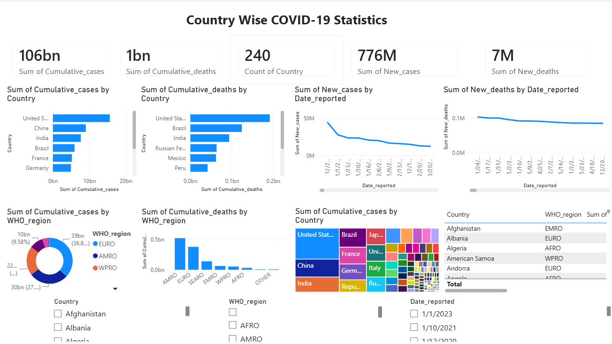

# COVID-19 Analysis (WHO Data)

## Objective
Track how COVID-19 cases and deaths changed across countries and regions over time.

## Dataset
58,560 weekly records from the WHO COVID-19 cases dataset, covering 240 countries and territories from Jan 2020 to Sep 2024.

## Tools Used
SQL Server (SSMS), Python (Pandas, Kaggle Notebooks), Power BI

## Approach
1. SQL: wrote queries for totals by country, region and time.
2. Python: cleaned the data and explored it with EDA.
3. Power BI: built an interactive dashboard to compare cases and deaths.

## Key Findings
- About 776 million cases and 7 million deaths recorded in total (about 0.9% of cases)
- Europe (EURO) has the largest share of cases, about 36%
- Most cases overall: United States, China and India

## Dashboard

## Files
- `Covid Analytics.sql`: SQL queries (SSMS)
- `covid-19-analytics.ipynb`: Python EDA notebook
- `Covid 19 Analytics.pbix`: Power BI dashboard
- `WHO COVID-19 cases.csv`: dataset
